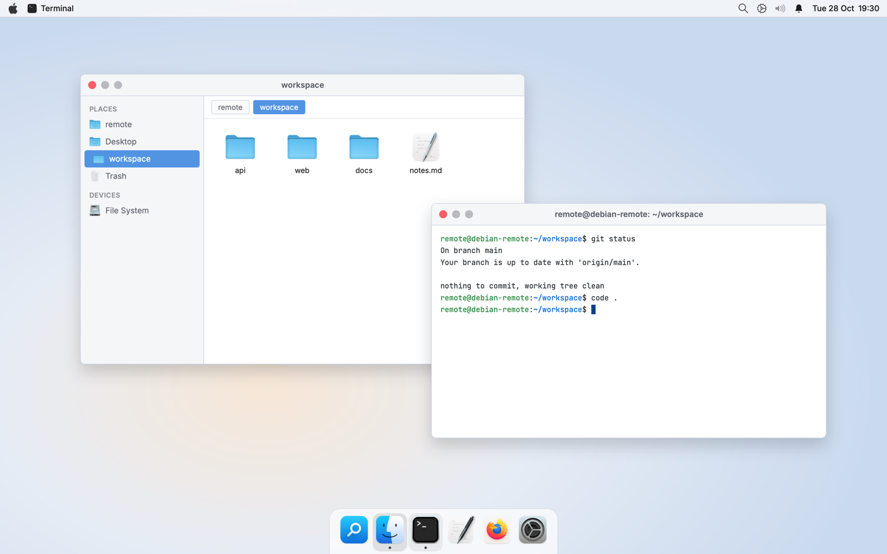
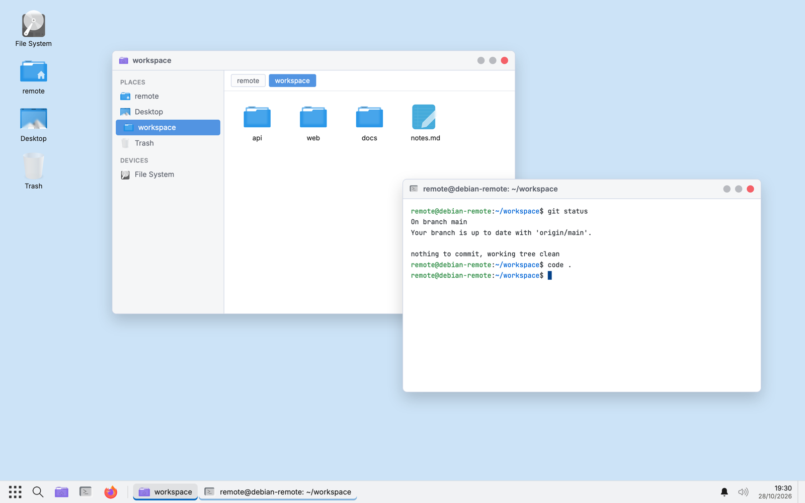

# Debian remote desktop in Docker

A Debian 13 (trixie) container with an XFCE 4.20 desktop, laid out like macOS or Windows, that you can reach from anywhere through:

- **Chrome Remote Desktop** (full graphical desktop in a browser or the CRD app)
- **VS Code tunnel** (open it from VS Code Desktop or vscode.dev)

Both services dial *out* to Google and Microsoft, so the container publishes no
ports and works behind NAT, on a home server, a VPS or a laptop.

## Files

| File | Purpose |
|---|---|
| `docker-compose.yaml` | The service, volumes and environment |
| `Dockerfile` | Debian trixie + XFCE + CRD host + VS Code CLI, non-root user, chosen desktop layout |
| `desktop/` | XFCE config for the `mac` and `windows` layouts plus shared theme settings |
| `apply-desktop-layout.sh` | Re-applies the image's layout to an existing home volume |
| `entrypoint.sh` | Runs as root at start: sets the user's password and sudo policy, then drops to the user |
| `services.sh` | Runs as the user: registers/starts the CRD host and the VS Code tunnel, restarts either if it dies |
| `.env.example` | Settings to copy to `.env` |
| `workspace/` | Bind-mounted into the container at `~/workspace` |

## Settings (`.env`)

| Variable | Used for |
|---|---|
| `COMPUTER_NAME` | Container hostname, VS Code tunnel name **and** Chrome Remote Desktop device name. Lowercase letters, digits, hyphens; max 20 characters |
| `USERNAME` | The Linux account inside the container. Baked into the image, so changing it needs a rebuild and a fresh home volume |
| `DESKTOP_LAYOUT` | `mac` or `windows`, baked in at build time (see **Desktop layout**) |
| `NODE_DEFAULT`, `DOTNET_CHANNELS` | Node major and .NET SDK channels baked in at build time (see **Developer tools**) |
| `USER_PASSWORD` | Password for that account. Applied at every start; `sudo` asks for it. Empty = passwordless sudo (a warning is logged) |
| `CRD_CODE`, `CRD_PIN` | One-shot Chrome Remote Desktop registration on first start (see below) |
| `VSCODE_TUNNEL_ENABLED` | `false` to run Chrome Remote Desktop only |
| `TZ`, `CRD_DESKTOP_SIZES`, `EXTRA_PACKAGES` | Timezone, virtual display sizes, extra apt packages (e.g. `firefox-esr`) |

## First run

```bash
cp .env.example .env     # set COMPUTER_NAME, USERNAME, USER_PASSWORD at least
docker compose up -d --build
docker compose logs -f
```

### VS Code tunnel

The log shows a line such as:

```
To grant access to the server, please log into https://github.com/login/device and use code XXXX-XXXX
```

Open that URL, enter the code and sign in with GitHub. The sign-in is stored in
the `home` volume, so it is only needed once. The machine then appears under
**Remote Explorer → Tunnels** in VS Code Desktop as `COMPUTER_NAME`, or at
`https://vscode.dev/tunnel/<COMPUTER_NAME>`.

To sign in with a Microsoft account instead of GitHub, do it once by hand
(replace `remote` with your `USERNAME`):

```bash
docker compose exec -u remote desktop code tunnel user login --provider microsoft
```

### Chrome Remote Desktop

**Option A: from `.env` (no shell needed).**

1. Open <https://remotedesktop.google.com/headless>, choose **Begin → Next → Authorise**,
   pick **Debian Linux**. The page shows a command containing `--code="4/0A..."`.
2. Put that value in `.env` as `CRD_CODE`, choose a `CRD_PIN` of at least six digits,
   then within a few minutes run:

   ```bash
   docker compose up -d --build
   ```

   The container registers the host as `COMPUTER_NAME` and starts it.
   `docker compose logs desktop` shows `Registration succeeded`, or why it failed.
   The code is single-use, so a second `up` does nothing until you paste a fresh one.
   If the container already exists, use `docker compose up -d --force-recreate`
   so the new `.env` values are picked up.
3. Afterwards you may blank `CRD_CODE` and `CRD_PIN` in `.env`; the registration
   is already stored in the `home` volume.

**Option B: by hand** (replace `remote` with your `USERNAME`).

```bash
docker compose exec -u remote desktop bash
```

Paste the command from the headless page **with `--no-start` appended** (there is
no systemd in the container; `services.sh` starts the host instead):

```
DISPLAY= /opt/google/chrome-remote-desktop/start-host --code="..." --redirect-url="..." --name=$(hostname) --no-start
```

It asks for a PIN. Within about 15 seconds the supervisor notices the new
registration and starts the host.

Either way the machine then appears at <https://remotedesktop.google.com/access>,
and the registration lives in `~/.config/chrome-remote-desktop/` inside the `home`
volume, so it survives restarts and image rebuilds.

## Desktop layout

`DESKTOP_LAYOUT=mac`



`DESKTOP_LAYOUT=windows`



*Renders of the shipped configuration with the real WhiteSur / Fluent icon artwork,
Inter and JetBrains Mono and the shipped wallpaper, not screenshots of a running
container.*

Set `DESKTOP_LAYOUT` in `.env` before building. Both layouts use the light Arc
theme and the Inter font; neither uses a dark theme. Icons match the platform:
WhiteSur (the macOS-style set) for `mac` and Fluent (the Windows 11-style set)
for `windows`, each pinned to a release and backed by KDE's Breeze set so any
icon they lack still renders. Neither pack ships a generic `start-here`
icon, so the menu button uses WhiteSur's Apple-style `start-here` in `mac` and
Fluent's four-square `view-app-grid-symbolic` in `windows`.

| | `mac` (default) | `windows` |
|---|---|---|
| Bar | Menu bar across the top: app menu and active-app menu on the left; search, settings, tray, notification bell and clock on the right | Taskbar across the bottom: Start, search, pinned File Explorer/Terminal/Browser, grouped task buttons; notification bell, tray, time-over-date clock and show-desktop corner on the right |
| Dock | Bottom centre, auto-width, pinned + running apps with dot indicators (docklike plugin) | none (task buttons live in the taskbar) |
| Window buttons | Close, minimise, maximise on the **left** | Minimise, maximise, close on the **right** |
| Backdrop | Soft peach-to-blue gradient wallpaper (`desktop/wallpaper/mac.jpg`, swap for any image) | Plain light-blue |
| Keys | Super+Space launcher, Super+Return terminal, Super+Q close, Super+M minimise, Super+Tab switch | Super opens Start, Super+E files, Super+R run, Super+D desktop, Super+Up/Left/Right maximise/tile |

From a Mac the Command key arrives as Super, so Cmd+Space, Cmd+Q and Cmd+Tab
behave as expected in the `mac` layout.

The layout is copied into the user's home when the home volume is first created.
To switch layouts on an existing volume, rebuild and re-apply (replace `remote`
with your `USERNAME`):

```bash
docker compose build && docker compose exec -u remote desktop apply-desktop-layout.sh && docker compose up -d --force-recreate
```

Anything you change later in XFCE's own settings dialogs is kept, since it lives
in the same home volume.

The panel chrome (translucent bars, rounded Dock, task-button underline, pop-up
corners) comes from `~/.config/gtk-3.0/gtk.css`, which you can edit and reload
with a new session. Thunar opens in icon view with the sidebar, the terminal uses
JetBrains Mono on a light GitHub-style palette, and the desktop shows no icons in
`mac` and This PC / user folder / Recycle Bin in `windows`.

## Developer tools

Baked into the image, available in Chrome Remote Desktop terminals and VS Code
tunnel terminals alike:

| Tool | What you get | Notes |
|---|---|---|
| Git | `git`, `git-lfs`, `openssh-client` | plus `build-essential`, `pkg-config`, `unzip` for native builds |
| Node | nvm v0.40.8 with Node `NODE_DEFAULT` (22) installed and set as default; Corepack enabled for pnpm/yarn | nvm lives in `/opt/nvm`, owned by your user, so `nvm install 20` etc. work as usual. Non-interactive processes see `/opt/node-default/bin` on `PATH`, which stays on the build-time default |
| Python | Debian 13's Python 3.13 with `pip`, `venv`, `pipx` and headers | Debian marks pip "externally managed": create a venv (`python3 -m venv .venv`) or use `pipx install <tool>` rather than `pip install` into the system |
| .NET | SDKs for each channel in `DOTNET_CHANNELS` (8.0 and 10.0) side by side in `/usr/share/dotnet` | installed with Microsoft's `dotnet-install.sh`, latest patch at build time; `dotnet --list-sdks` lists them. Telemetry is off. Global tools go to `~/.dotnet/tools`, already on `PATH` |

.NET 8 leaves Microsoft support on 10 November 2026, so start new projects on
.NET 10; drop `8.0` from `DOTNET_CHANNELS` once nothing needs it. Rebuild to pick
up new SDK patches or a different Node default:

```bash
docker compose build --pull && docker compose up -d
```

Caches and per-user state (`~/.npm`, `~/.nuget`, `~/.dotnet`, `~/.cache/pip`,
`~/.local`) live in the `home` volume and survive rebuilds.

## Day-to-day

```bash
docker compose logs -f desktop            # both services log here
docker compose restart desktop
docker compose exec -u remote desktop bash   # shell as your user (sudo asks for USER_PASSWORD)
docker compose exec desktop bash          # root shell
docker compose down                       # stops; the home volume is kept
docker compose down -v                    # also deletes the home volume (both sign-ins lost)
```

Changing `USER_PASSWORD` or `COMPUTER_NAME` in `.env` takes effect on the next
`docker compose up -d --force-recreate`. Note that a renamed computer registers a
*new* tunnel name, while the existing Chrome Remote Desktop registration keeps its
old display name until you re-register.

Rebuild to pick up new CRD / VS Code CLI releases:

```bash
docker compose build --pull --no-cache && docker compose up -d
```

## Notes and gotchas

- **Architecture.** Google only publishes the CRD host for amd64, so the image is
  pinned to `linux/amd64`. On Apple Silicon Docker Desktop runs it under
  emulation, which works but is slow; a Linux amd64 host is the intended home.
- **Browser inside the desktop.** `EXTRA_PACKAGES=firefox-esr` bakes in Firefox.
  Chromium can be added too, but inside a container it must be launched with
  `--no-sandbox`.
- **Audio** is not configured (no PipeWire/PulseAudio). CRD logs a warning and
  carries on.
- **Security.** Anyone with your Google account + PIN or your GitHub/Microsoft
  account can reach this desktop. `USER_PASSWORD` and `CRD_PIN` sit in plain text
  in `.env` (gitignored); blank `CRD_PIN` once registered. The container runs
  unprivileged with no extra capabilities; only the short start-up runs as root.
- **Resolution.** `CRD_DESKTOP_SIZES` sets the sizes the virtual display offers;
  the CRD client can also resize to fit its window.
